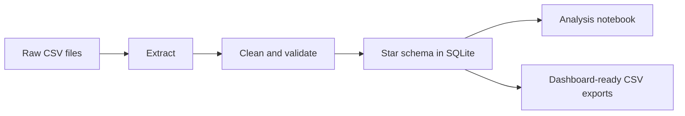
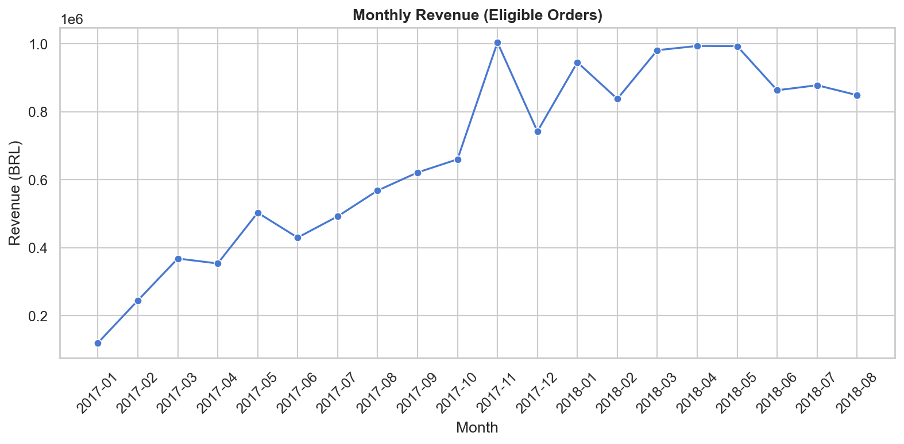
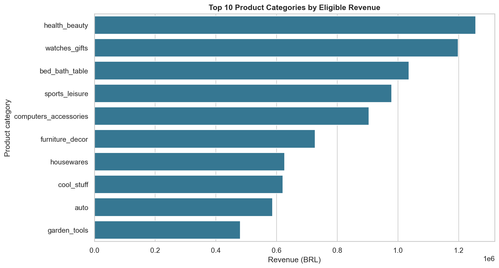
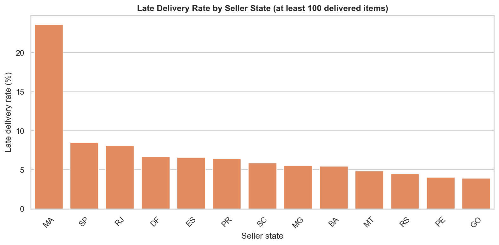

[](https://github.com/YOUR_USERNAME/YOUR_REPOSITORY/actions/workflows/ci.yml)

# E-commerce ETL Pipeline

A Python project foundation for analyzing the public Olist Brazilian E-Commerce dataset. The planned pipeline will take the source CSV files through cleaning and modeling, then make the data available for analysis and a dashboard.

## Quick Start

Download the full Olist CSV dataset separately for a real-data run and place the nine files in `data/raw/`. From the project root in PowerShell:

```powershell
py -m venv .venv
.\.venv\Scripts\Activate.ps1
python -m pip install -r requirements.txt
python -m src.run_pipeline
```

The final command validates and processes the raw files, loads SQLite, checks quality, and exports dashboard data.

## Reproduce with Sample Data

The repository includes a seeded 500-order sample under `data/sample/raw/`, so the sample run does not require the full dataset:

```powershell
python -m src.run_pipeline --sample
```

Sample outputs, including its SQLite file, quality report, dashboard CSVs, logs, and `pipeline_run_summary.json`, are isolated under `data/sample/output/`. To rebuild or refresh the committed sample from the full raw dataset, run `python -m src.make_sample`; it retains up to five geolocation observations per required ZIP prefix and enforces a 5 MB size limit.

### Configuration Overrides

- `ETL_RAW_DIR` selects the directory containing the nine raw CSVs.
- `ETL_DB_PATH` selects the SQLite database file.
- `ETL_OUTPUT_DIR` selects the output root; processed CSVs/reports go to `<root>/data/processed/`, exports to `<root>/dashboard/data/`, logs to `<root>/logs/`, and the run summary to `<root>/pipeline_run_summary.json`.

When unset, these resolve to the existing project paths. The `--sample` option sets all three for the committed sample and its isolated output directory.

## Architecture



## Planned Architecture

**Extract -> Transform -> Load -> Analyze -> Dashboard**

- **Extract:** Read the Olist CSV files from `data/raw/`.
- **Transform:** Clean and prepare data for analysis.
- **Load:** Store the modeled data in SQLite using a star schema.
- **Analyze:** Explore results in a Jupyter notebook.
- **Dashboard:** Present key metrics in an interactive dashboard.

## Dataset

This project uses the public Olist Brazilian E-Commerce dataset, available from [Kaggle](https://www.kaggle.com/datasets/olistbr/brazilian-ecommerce). Download the dataset separately and place the nine expected CSV files in `data/raw/`. Raw data files are excluded from Git.

### Attribution and License

The Kaggle dataset page lists the **CC BY-NC-SA 4.0** license. Attribute the dataset to Olist and follow the license terms: attribution, non-commercial use, and share-alike. The committed small sample is derived from the dataset and remains subject to those terms. The full raw dataset is not included in this repository.

## Setup

From the project root, create and activate a virtual environment in PowerShell:

```powershell
py -m venv .venv
.\.venv\Scripts\Activate.ps1
```

If PowerShell blocks activation, allow it for the current terminal session and activate again:

```powershell
Set-ExecutionPolicy -ExecutionPolicy RemoteSigned -Scope Process
.\.venv\Scripts\Activate.ps1
```

Install the pinned dependencies:

```powershell
python -m pip install -r requirements.txt
```

In VS Code, select the `.venv` interpreter for this project. After adding all expected CSVs to `data/raw/`, run the raw-file validation check:

```powershell
python -m src.validate_raw
```

The validator writes timestamped status messages to the console and `logs/pipeline.log`. If any expected CSV is missing, it reports the missing files and exits with a non-zero status.

## Stage 2: Extract and Clean

After all nine source CSVs are in `data/raw/`, run extraction and cleaning from the project root:

```powershell
python -m src.run_stage2
```

The command saves one cleaned CSV per table and `cleaning_summary.csv` in `data/processed/`. The summary reports row counts, duplicate rows removed, and null-cell counts before and after cleaning. Progress and validation details are also written to `logs/pipeline.log`.

### Cleaning Rules

- All tables have exact duplicate rows removed and surrounding whitespace stripped from text values.
- Order timestamps are parsed; delivery duration and delay fields are added while undelivered orders remain in the data with null delivery results.
- Item and payment amounts are converted to numeric values; invalid or negative amounts stop the run with an error.
- Reviews keep the latest row for each non-null review ID and receive a `has_comment` flag.
- Product categories are translated to English when available, with `unknown` used for missing or unmatched categories.
- Customer, seller, and geolocation city/state values are normalized; geolocation is aggregated to one row per ZIP prefix.

## Stage 3: SQLite Star Schema

After Stage 2 has created the cleaned CSVs, build and validate the SQLite database:

```powershell
python -m src.run_stage3
```

The loader recreates `database/olist.sqlite3` on each run, so repeated runs do not append duplicate rows. It writes `data/processed/load_quality_report.csv`, executes the five example queries in `sql/sample_queries.sql`, and logs load counts, check results, and query previews to `logs/pipeline.log`.

```text
						  dim_date
							  |
dim_customers -- fact_sales -- dim_products
							  |
						dim_sellers

fact_payments (separate order-payment grain)
fact_reviews  (separate review grain)

dim_geolocation (ZIP-prefix lookup dimension)
```

`fact_sales` is one row per order item and uses `order_id` plus `order_item_id` as its composite primary key. Payments and reviews remain separate facts, avoiding revenue multiplication when an order has multiple payments, reviews, or items.

## Stage 4: Analysis and Dashboard Data

Run the dashboard export and execute the analysis notebook from the project root:

```powershell
python -m src.export_dashboard_data
jupyter nbconvert --to notebook --execute --inplace notebooks/analysis.ipynb
```

The exporter writes tidy CSVs to `dashboard/data/`. The notebook reads only `database/olist.sqlite3` and saves its charts under `notebooks/figures/`. Both use eligible revenue (`SUM(price)`, excluding canceled and unavailable orders), and ranked rate/average views use a 100 delivered-item seller-state threshold or a 50-review category threshold. Trend analysis excludes 2016 and the last incomplete month.

### Key Findings

- Eligible monthly revenue peaked in **November 2017 at BRL 1,003,862** in the complete-month trend window (January 2017 to August 2018).
- The top 10 product categories contributed **62.4%** of eligible revenue; `health_beauty` led at **BRL 1,255,695**.
- Among seller states with at least 100 delivered items, **MA** had the highest late-delivery rate at **23.6%**.
- Average review score was **4.30 for on-time orders** versus **2.57 for late orders**, after reducing delivery and review data to order level.
- **3.1%** of purchasing customer identities placed more than one order; **SP** was the largest customer-state market at **BRL 5,163,867** in eligible revenue.
- Credit cards represented **78.5%** of eligible-order payment value.

### Analysis Charts







`dashboard/data/sales_detail.csv` is generated and ignored by Git. It is currently about 35.6 MB, so regenerate it after a fresh clone with `python -m src.export_dashboard_data` or `python -m src.run_pipeline` after placing the full raw dataset and running the pipeline.

## Project Structure

```text
ecommerce-etl/
├── .github/workflows/ci.yml
├── data/
│   ├── raw/                 # Full source CSVs, ignored by Git
│   ├── sample/raw/          # Small committed CI sample
│   └── processed/           # Generated cleaned tables and reports
├── dashboard/data/          # Generated Power BI/Tableau CSVs
├── database/                # Generated SQLite database
├── docs/                    # Data dictionary and design decisions
├── notebooks/               # Executed analysis notebook and figures
├── src/                     # ETL modules and runnable commands
├── sql/                     # SQLite schema and example queries
└── tests/                   # Unit and integration tests
```

## Skills Demonstrated

- Python ETL design, configuration, logging, and reproducible CLI workflows
- Pandas data validation, cleaning, joins, and feature derivation
- SQL and SQLite star-schema modeling with fact-table grain control
- Data-quality assertions, referential integrity, and financial reconciliation
- Exploratory analysis, matplotlib/seaborn reporting, and dashboard data preparation
- Pytest integration tests, Git hygiene, and GitHub Actions CI

## CI Badge Setup

At the top of this README, replace both `YOUR_USERNAME` and `YOUR_REPOSITORY` in the badge image URL and link with your GitHub account name and repository name.

## Project Status

- [x] Stage 1: Project foundation, configuration, logging, and raw-file validation
- [x] Stage 2: Extract and clean source data
- [x] Stage 3: SQLite star schema and load-quality validation
- [x] Stage 4: Analysis notebook and dashboard-ready exports
- [x] Stage 5: Reproducible pipeline, sample data, CI, and repository documentation
- [ ] Dashboard: build manually in Power BI or Tableau
